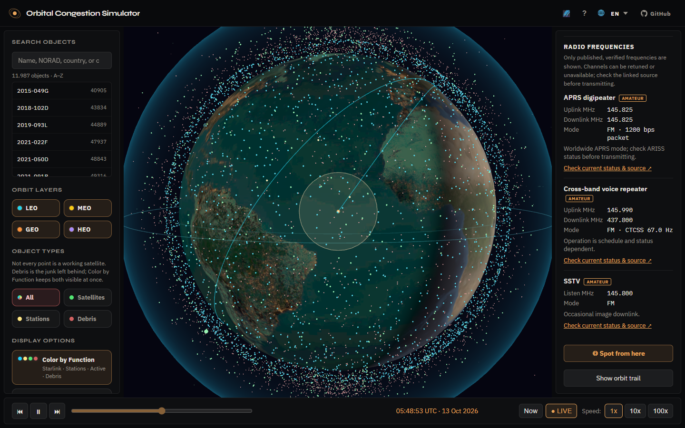
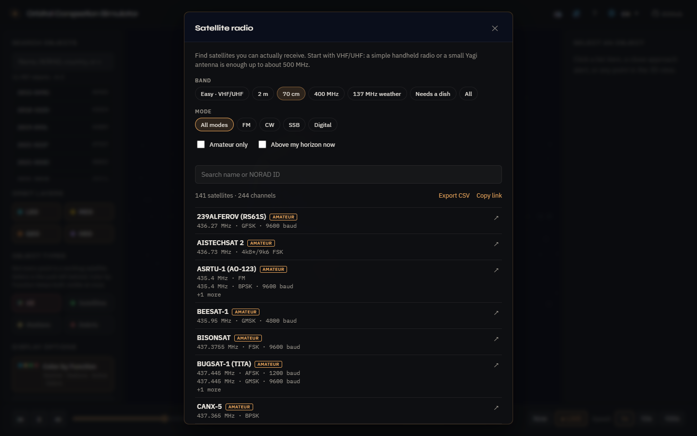

# Orbital Congestion Simulator

> An open-source, real-time 3D view of Earth’s orbital traffic: about 28,000 satellites, debris fragments and rocket bodies, close-approach screening, upcoming launches, and a filterable radio panel for amateur-radio operators.

**Live demo:** [https://orbital-congestion.vercel.app](https://orbital-congestion.vercel.app)





## What it does

Orbital Congestion Simulator renders thousands of satellites and debris fragments orbiting Earth in real time. It uses Two-Line Element (TLE) data from CelesTrak, refreshed daily by an automated pipeline, and propagates each object with the SGP4 algorithm via [satellite.js](https://github.com/shashwatak/satellite-js) in your browser.

Explore orbit layers (LEO, MEO, GEO, HEO), filter by congestion type, click any object to inspect its orbital parameters, scrub through time, replay historical collisions, and inspect close-approach pairs in a dedicated verification view.

### Highlights

- **A radio panel for amateur-radio operators** — filter the satellites you can actually receive by band (starting with *Easy · VHF/UHF*, the ~425 satellites a handheld radio or small Yagi can hear, out of ~5,900 with published frequencies), mode, and amateur-only. **Above my horizon now** lists what is up at your location (from your device, or typed-in coordinates) above an adjustable minimum elevation, with next-pass times. Each amateur satellite links to its recent SatNOGS observations. Export the list as CSV or share a link that carries your filters. Frequencies come from SatNOGS DB and AMSAT, and amateur channels carry an **AMATEUR** badge.
- **Upcoming launches** — the next rocket launches (and any in flight) with rocket, pad, destination and a live countdown; pick one to mark its pad on the globe or jump to the ISS for resupply missions.
- **Honest about accuracy** — close approaches are screening estimates from public TLEs, not operational conjunction assessments, and the app says so wherever they appear. Launches are schedules, not live tracking.
- **Private by design** — no cookies, accounts, ads or third-party requests; only anonymous, cookieless visit counts. Fonts are self-hosted, and launch data is fetched by the site’s own server function.
- **Works on a phone** — responsive layout (side panels slide in as drawers; on a computer they collapse to give the globe more room), a guided tour, and a Spotter mode that points you at a satellite using your phone’s sensors. Available in English, Turkish, German, Russian and Chinese.

## Features

- **Live 3D globe** with instanced orbital points, day/night Earth shading, and a LEO shell reference ring
- **Orbit layers & filters** — LEO / MEO / GEO / HEO; satellites / stations / debris; search; altitude & inclination ranges
- **Color by Function** — Starlink, stations, active payloads, debris and amateur-radio satellites at a glance, in a colour-blind-friendly palette (amateur satellites are also drawn larger)
- **New to this catalog** — filter objects first seen in this app’s TLE list within the last 14 days (`firstSeenAt`)
- **Object details** — altitude, velocity, country/owner, orbit trail, ground track, footprint, and published radio-frequency metadata
- **Docked stacks as one object** — the catalog lists every station module and docked vehicle separately, but they share one published orbit. The ISS, the Chinese space station and similar stacks are shown as a single object with their docked parts listed; searching for a module (e.g. “Nauka”) or linking to its NORAD number opens the stack, and a vehicle that undocks separates automatically
- **Radio-frequency reference** — verified uplink, downlink, beacon/listening frequencies, modulation modes, operational notes, and direct source links for supported spacecraft and constellations. Channels the sources identify as amateur-radio services carry an **AMATEUR** badge and are listed first
- **Radio panel** — the header **Radio** button opens a filterable list of the satellites you can actually receive: bands (Easy VHF/UHF up to 500 MHz, 2 m, 70 cm, 400 MHz, 137 MHz weather, or the dish bands), modes (FM, CW, SSB, digital), amateur-only, and **above my horizon now** with an adjustable minimum elevation and next-pass times; links to each satellite’s recent SatNOGS observations. Export the list as CSV or copy a link that carries your filters
- **Close-approach alerts** — next-24h scanning with sortable cards and a VERIFY playback mode (T−60s → CPA → T+15s)
- **Upcoming launches** — the next rocket launches (and any in flight) with rocket, provider, pad, destination and a live countdown; pick one to mark its pad on the globe, or jump to the ISS for resupply missions
- **Historical event replays** — seven landmark collisions, ASAT tests, and breakups
- **Kessler “Future Projection”** — header projection panel with live scenario sliders, charts, and narrative (no separate run button)
- **Satellite Spotter** — mobile sky guide using device sensors and magnetic declination correction
- **Interactive how-to tour** — language gate + spotlight walkthrough (header `?`)
- **i18n** — English, Turkish, German, Russian, Chinese
- **Deep links** — `?object=<NORAD>` / `?event=<id>` / `?radio=<band>&mode=<mode>&amateur=1` (shareable radio filters)
- **Automated TLE refresh** — daily GitHub Actions update (TLE + SATCAT country join + radio data), published without growing the repository

## Why it matters

Earth orbit is increasingly crowded. About **40,000** objects larger than 10 cm are tracked in near-Earth space (this globe shows the ~28,000 of them with public orbit data: every active satellite, every catalogued debris fragment and spent rocket body). Collisions like Iridium 33–Cosmos 2251 demonstrated the Kessler Syndrome risk — where one collision creates debris that triggers more collisions. Operators like SpaceX perform hundreds of collision-avoidance maneuvers each year. This simulator makes that invisible traffic visible.

## Tech stack

| Layer | Technology |
|-------|------------|
| Build | Vite 6 + TypeScript (strict) |
| 3D | Three.js |
| Orbital mechanics | satellite.js (SGP4) + Web Worker batch propagation |
| Testing | Vitest (unit) + Playwright (e2e) |
| Data | CelesTrak TLE and SATCAT, AMSAT and SatNOGS radio catalogs, and official constellation frequency plans |
| Server | A single serverless function (`api/launches.js`) that fetches and caches launch data |
| Deploy | [Vercel](https://orbital-congestion.vercel.app) — `vercel.json` sets a Content-Security-Policy and other security headers |

## Getting started

**Requirements:** Node.js 22.22 or newer, a WebGL-capable browser (without WebGL the app shows an explanatory message instead of the 3D view).

```bash
git clone https://github.com/muhammet842/orbital-congestion-simulator-premium.git
cd orbital-congestion-simulator-premium
npm install
npm run dev
```

Open `http://localhost:5173`. The repo ships a seed `public/data/tle.json` (it can be days old, so the app may show its staleness warning). Run `npm run pull-data` to fetch the latest published snapshot, or `npm run fetch-tle` for a fresh CelesTrak pull.

## Development & testing

```bash
npm run dev          # Vite dev server
npm run build        # tsc + production bundle
npm run preview      # serve the production build locally
npm test             # Vitest unit tests (npm run test:watch re-runs on change)
npm run test:e2e     # Playwright (Chromium + mobile-chrome)
npm run test:all     # unit + e2e
npm run check:i18n   # translation key parity (en/tr/de/ru/zh)
npm run pull-data    # fetch the latest published catalog snapshot (see Data source)
npm run fetch-tle    # fresh pull from CelesTrak into your local public/data/tle.json
npm run screenshot   # refresh docs/screenshot-en.png, docs/screenshot-radio.png and public/og-image.png after UI changes
                     # (no Playwright browsers? PW_CHANNEL=msedge npm run screenshot)
```

CI (GitHub Actions): build + unit tests on every push/PR; Playwright e2e on `main` pushes and PRs into `main`.

## Project structure

| Path | What lives there |
|------|------------------|
| `src/orbital/` | SGP4 propagation, conjunction screening, look angles, sky projection, Kessler model |
| `src/scene/` | Three.js scene: globe, instanced points, orbit trails, replay and verification visuals |
| `src/ui/` | Panels, tour, Spotter, time controls, shared helpers such as HTML escaping |
| `src/data/` | Catalog loading and validation, object metadata, radio frequencies |
| `src/state/`, `src/routing/` | App state store and `?object` / `?event` deep links |
| `src/i18n/` | Translations (en/tr/de/ru/zh) |
| `src/styles/` | Styles, one file per part of the app; `src/style.css` lists them in cascade order. Tokens (colours, spacing, radii) are in `base.css` |
| `api/` | One Vercel serverless function, `/api/launches`, behind the Upcoming Launches panel |
| `src/workers/` | Web Workers for batch propagation and the 24 h close-approach sweep |
| `scripts/` | Catalog refresh and enrichment, snapshot pull, screenshot and i18n tooling |
| `e2e/` | Playwright tests (desktop and mobile) |
| `docs/` | Operations notes and the screenshot |

## How to use

On first visit the app asks you to **choose a language**, then walks through the UI step by step with on-screen highlights (globe, search/filters, details, close approaches, upcoming launches, historical events, time bar, Radio, Future Projection). Use **Skip** anytime; reopen the tour with the **?** button in the header.

Select a spacecraft to inspect its orbital parameters and, when published data is available, its radio services, uplink and downlink frequencies, receive-only channels, transmission modes, operational notes, and linked reference sources. Frequency details are intentionally omitted for debris objects.

On phones the side panels open as drawers and the radio table switches to a stacked card layout. On a computer the same ☰ and ℹ buttons in the header **collapse** the side panels so the globe fills the space; your choice is remembered, and picking a satellite re-opens the details panel.

In the radio table, the **AMATEUR** badge appears only where the source data says a channel is an amateur-radio service. Channels confirmed as other services (weather, navigation, broadband…) are dimmed and listed last. A channel with no badge and no dimming is simply **unclassified** by its source, which is not the same as not being amateur.

The **Radio** button (📻) in the header opens the radio panel. It starts on **Easy · VHF/UHF** (about 425 satellites a simple handheld radio or small Yagi can hear); narrow it with a band chip such as **70 cm**, a mode such as **CW**, **Amateur only**, or a name / NORAD search. **Above my horizon now** lists what is up at your location, highest first, with next-pass times for the rest. Ticking it asks the browser for your location once (no tracking) or uses the one saved by the Spotter; if the device cannot locate itself, type latitude and longitude instead. **Min. elevation** (Any, 5°, 10°, 15°) hides satellites too low above the horizon to receive well. Each amateur satellite has a **SatNOGS** link to its recent observations (waterfalls and audio). Click a row to open that satellite, **Export CSV** to download the list, or **Copy link** to share the exact filters (e.g. `?radio=ham70cm&mode=fm&amateur=1`).

In **Upcoming Launches**, click a launch to fly to its pad and mark it on the globe (click again to clear it). For missions to the International Space Station, **Show ISS** selects the station. Countdowns use real time, whatever time the globe is showing. When a webcast is known, **Watch** opens it in a new tab.

Deep links: `?object=<NORAD>`, `?event=<id>` and `?radio=<band>` (with optional `mode`, `amateur=1` and `rq` search), for example `?radio=ham70cm&mode=fm&amateur=1`.

## Data source

Orbital elements and catalog metadata come from [CelesTrak](https://celestrak.org/):

- **TLE / GP** — every active satellite (CelesTrak’s `active` group, about 16,000 in 2026, including all of Starlink and OneWeb), every catalogued debris fragment (the Cosmos 2251, Fengyun-1C, Iridium 33 and Cosmos 1408 clouds plus all other `DEB` objects) and spent rocket bodies (`R/B`), and stations (ISS and Tiangong modules plus visiting vehicles). Objects are re-categorised by name, so rocket bodies listed in active groups count as debris unless they transmit; unidentified analyst tracks are left out
- **SATCAT** — one download of [`satcat.csv`](https://celestrak.org/pub/satcat.csv) joined by NORAD ID so each object can carry a **country** (and organization **owner** when SATCAT’s `OWNER` is an agency/consortium code). Name-based heuristics in `objectMetadata.ts` remain the fallback when SATCAT has no match or only supplies a country code (so operators like SpaceX can still come from the name).
- **AMSAT and SatNOGS** — published amateur-radio and active transmitter records joined by NORAD ID. Only confirmed, operationally valid SatNOGS transmitter entries are retained. A channel gets the **AMATEUR** badge only when every frequency it lists falls in an ITU amateur band, so 401 MHz space-operation and 2.2 GHz S-band links on amateur CubeSats are left unbadged. Satellites with an active SatNOGS amateur channel that no fetched CelesTrak group contains are fetched by catalog number (100 spacecraft slots are reserved for them). When CelesTrak publishes no elements at all for one of them (LAPAN-A2 / IO-86, for example), the SatNOGS DB’s own TLE is used instead, but only if it is at most 30 days old; the app then says so in the object’s details, since positions and pass times from such elements are approximate.
- **Launches** — [Launch Library 2](https://thespacedevs.com/llapi) by The Space Devs (free tier, 15 requests per hour per IP). The browser never contacts it: the site’s `/api/launches` function fetches it server-side and caches the result (details in [docs/OPERATIONS.md](docs/OPERATIONS.md#launch-data)).
- **Official constellation plans** — documented service bands for supported Galileo, GPS, BeiDou, Starlink, and OneWeb spacecraft families.

Output: `tle.json` — about **28,000 objects** (limits: 22,000 spacecraft, 18,000 debris), deduplicated by NORAD ID. (`public/data/tle.json` in the repo is a seed; the live catalog is published by the daily workflow, see below.)

A [GitHub Actions workflow](.github/workflows/tle-refresh.yml) runs `npm run fetch-tle` every day, refreshes TLEs, re-joins SATCAT and radio-frequency sources, and publishes the catalog to a single-commit `data` branch (so the repository does not grow by ~11 MB a day). It then commits a tiny pointer, `public/data/data-ref.json`, to `main`, which redeploys the site; the Vercel build downloads that exact snapshot (`scripts/pull-data.mjs`). This keeps the deployed app under the in-app 3-day staleness warning. Manual refresh:

```bash
npm run fetch-tle
```

Radio-frequency enrichment is best-effort: an upstream radio catalog outage does not block fresh orbital data. Previously verified entries are retained when possible, while curated spacecraft records and official constellation profiles remain available.

### Credits and data licenses

- **[CelesTrak](https://celestrak.org/)** — orbital elements (GP/TLE) and SATCAT, which CelesTrak makes freely available to the space community.
- **[SatNOGS DB](https://db.satnogs.org/)** (Libre Space Foundation) — transmitter data (and fallback TLEs for a few amateur satellites CelesTrak does not cover), licensed [CC BY-SA 4.0](https://creativecommons.org/licenses/by-sa/4.0/). Radio-frequency entries derived from it keep that license: credit SatNOGS DB and share any reuse alike.
- **[The Space Devs](https://thespacedevs.com/)** — launch schedule data (Launch Library 2); please keep the credit shown under the launch list if you reuse it.
- **AMSAT** amateur-satellite frequency lists, via [palewire/amateur-satellite-database](https://github.com/palewire/amateur-satellite-database) (an MIT-licensed repository).
- **Constellation frequency plans** (Galileo, GPS, BeiDou, Starlink, OneWeb) come from public specifications and filings; each row links to its source.
- **3D satellite model** — [NASA Science 3D Resources](https://science.nasa.gov/3d-resources/) (see 3D models below); **Earth textures** — [NASA Visible Earth](https://visibleearth.nasa.gov/); **fonts** — see Fonts below.

### “NEW” objects filter

Objects can carry a `firstSeenAt` stamp when they first appear in an automated fetch relative to the previous catalog snapshot. The UI filter **“New to this catalog”** uses that stamp — it means **first seen in this app’s TLE list within the last 14 days**, not the physical launch or formation date (and not SATCAT `LAUNCH_DATE`). Stamps accumulate across refreshes; a cold/empty baseline does not mark the whole catalog as new. See [docs/NEW_OBJECTS.md](docs/NEW_OBJECTS.md).

## Security notes

- Catalog text (names, owners, countries) comes from an external feed and is HTML-escaped (`src/ui/escapeHtml.ts`) before it reaches the DOM; external links are limited to http(s).
- `public/data/tle.json` is validated at load time (`src/data/validateDataset.ts`) and again in `npm test`, which the TLE refresh workflow runs before publishing a new snapshot.
- If you add a new origin (fonts, tiles, APIs), update the CSP in `vercel.json`.

## Privacy

- No cookies, accounts, ads or cross-site tracking. The live site counts visits anonymously with [Vercel Web Analytics](https://vercel.com/docs/analytics/privacy-policy): no cookies, anonymous (visitors are counted with a hash that resets every day, so nobody can be followed across days or sites), and served from the site’s own origin. It shows page views, referring sites, countries and device types; your Spotter or Radio-panel location is never sent. After the page loads, the app only talks to its own origin (fonts are self-hosted too). Launch data is fetched from The Space Devs by the site’s server function, so your browser never contacts them and nothing about you is sent.
- Three small items are kept in your browser's local storage and never sent anywhere: your language, whether you have seen the tour, and — only if you use the Spotter or the Radio panel’s **Use my location** — your last observer location.
- Location and device-motion permissions are requested only when you use the Spotter (or press **Use my location** in the Radio panel), and the browser asks you first. The Radio panel asks once; it never tracks you.

## Limitations (read before demoing)

- **Close approaches are screening estimates, not operational conjunction assessments** — they are computed from public TLEs, which typically carry a kilometre or more of position error and no uncertainty (covariance) data. Treat distances and risk labels as illustrative; real operators use higher-precision tracking.
- **Radio bands are typical ranges, not allocations** — amateur band edges differ by region, so the presets are a search aid. “Above my horizon now” uses a minimum elevation you can set (default 5°; the globe’s footprint circle shows 15° and above), and depends on TLE accuracy and your location; frequencies come from published sources and can be retuned, and Doppler shift moves a signal by several kHz during a pass. A channel with no AMATEUR badge may simply be unclassified by its source.
- **Alert threshold** — the list shows pairs predicted to pass within 3 km in the next 24 hours. On a busy day that is thousands of events, so the app shows the few most relevant and a "+N more" count.
- **Online only** — there is no offline mode or installable app; the catalog and the page are fetched on each visit.
- **Launches are schedules, not tracking** — times are “no earlier than” estimates that often slip, and the data can lag by up to ~15 minutes. The globe marks the launch pad only; there is no live position for a rocket in flight, because no public feed provides one.
- **Not live tracking** — positions are propagated from static TLE snapshots with SGP4; there is no real-time position API.
- **Educational scale** — in VERIFY close-approach mode, 3D models shrink to stay smaller than the computed miss distance so pairs do not visually overlap at sub-kilometre CPAs.
- **Projection panel** — Kessler “Future Projection” is a simplified what-if model, not an official debris forecast (see the in-panel disclaimer).
- **TLE age** — Live Stats shows when `tle.json` was last fetched; a warning appears after ~3 days without refresh.
- **Radio-frequency use** — displayed frequencies are a reference compiled from published sources, not operating authorization. Services may be retuned, inactive, geographically restricted, or subject to licensing; verify the linked source and applicable regulations before transmitting.

## Orbital mechanics

Each object is propagated with **SGP4** (Simplified General Perturbations 4), the standard model used by NORAD for TLE-based prediction. Positions are computed in Earth-Centered Inertial (ECI) coordinates and scaled for Three.js display (1 unit = Earth radius).

Orbit layers are classified by altitude and eccentricity:

| Layer | Altitude |
|-------|----------|
| LEO | &lt; 2,000 km |
| MEO | 2,000 – ~32,000 km |
| GEO | ~35,786 km ± 500 km |
| HEO | High eccentricity (&gt; 0.25) |

## 3D models

`public/models/sat_leo.glb` is the bundled LEO satellite mesh: NASA’s [Active Cavity Irradiance Monitor Satellite (AcrimSAT) (A)](https://science.nasa.gov/3d-resources/active-cavity-irradiance-monitor-satellite-acrimsat-a/) model from [NASA Science 3D Resources](https://science.nasa.gov/3d-resources/), used unmodified under NASA’s [media usage guidelines](https://www.nasa.gov/nasa-brand-center/images-and-media/). Stations, cargo craft, cubesats, and debris use **distinct procedural silhouettes** (see `SatelliteModelLoader`) so types stay visually readable without multi‑MB artist GLBs. Dropping additional `.glb` files at the paths in `modelResolver.ts` and marking them as bundled will take priority automatically.

## Fonts

[IBM Plex Sans](https://github.com/IBM/plex), [IBM Plex Mono](https://github.com/IBM/plex) and [Syne](https://fonts.google.com/specimen/Syne) (SIL Open Font License 1.1), self-hosted through [Fontsource](https://fontsource.org/) — the app makes no third-party requests, and the CSP in `vercel.json` only allows fonts from its own origin.

## Earth texture

Day and night maps sourced from [NASA Visible Earth](https://visibleearth.nasa.gov/) (Blue Marble). Stored locally at `public/textures/earth.jpg` and `public/textures/earth-night.jpg` and blended in a custom shader for the terminator.

## Operations

- Operations checklist: [docs/OPERATIONS.md](docs/OPERATIONS.md)

## Quick test guide (reviewers)

Open the [live demo](https://orbital-congestion.vercel.app) (desktop first). Skip or finish the short tour, then try:

1. **Color by Function** (Display Options) — Starlink / stations / active / debris / amateur radio become readable at a glance.
2. **Search** `ISS` or `25544`, select it, inspect the sourced radio-frequency table, and toggle orbit trail / ground track on the right.
3. **Historical Events** — start with Iridium 33 ↔ Cosmos 2251; scrub or Exit when done.
4. **Close Approach Alerts** — if cards appear, open one for VERIFY playback (may take a minute to scan).
5. **Future Projection** — open the projection panel from the header and move the sliders (no separate Run).
6. **Radio** — tap the 📻 header button; try **70 cm** + **CW**, **Amateur only**, then **Above my horizon now** (allow location) and **Export CSV**.
7. **Phone** — select a bright target → **Spot from here**; allow location/motion. Outside + figure-eight if the compass drifts.

Positions are SGP4 from a periodic TLE snapshot, not a live tracking API.

## If the live catalog looks wrong

Healthy catalog: **~28,000** objects and **stations** (ISS / Tiangong) visible in Live Stats. A thin fetch once shipped ~3.5k objects and zero stations.

1. Check GitHub → **Actions → TLE Refresh** (and CI).
2. Locally: `npm run fetch-tle` — the script **refuses** to overwrite `public/data/tle.json` if totals/stations/active/debris fall below hard minimums, or if any category (or the total) drops more than 15% versus the previous file (override an intentional drop with `ALLOW_CATALOG_DROP=1`).
3. If the fetch succeeds with a full catalog, run the **TLE Refresh** workflow from the Actions tab (don't commit `tle.json` by hand — see [docs/OPERATIONS.md](docs/OPERATIONS.md#where-the-data-lives)).
4. On the deployed site, confirm **Live Stats → TLE data updated** and object counts.

Details: [docs/OPERATIONS.md](docs/OPERATIONS.md).

## Contributing

Issues and pull requests are welcome — see [CONTRIBUTING.md](CONTRIBUTING.md); security problems go through [SECURITY.md](SECURITY.md). Before opening a PR, run `npm run build`, `npm test` and `npm run check:i18n`. New UI text must be added to all five languages in `src/i18n/translations.ts` (parity is checked in CI), and PRs into `main` also run the Playwright suite. Please don't commit refreshed catalogs by hand — see [docs/OPERATIONS.md](docs/OPERATIONS.md).

## Author

Created by **Muhammet Emin Ballı** ([@muhammet842](https://github.com/muhammet842)). Feedback, bug reports and ideas are very welcome — please [open an issue](https://github.com/muhammet842/orbital-congestion-simulator-premium/issues).

## License

[MIT](LICENSE)
