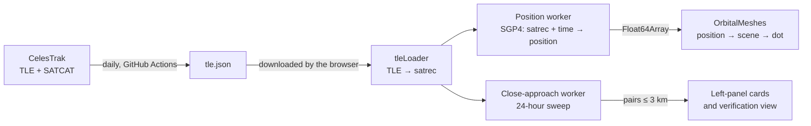

# Architecture: from a TLE to a dot on the screen

This document briefly explains how the app finds and draws a satellite's position, how it screens for close approaches, and why the heavy calculations run in Web Workers. Each section links to the files involved.

## 1. Data: where the TLEs come from

- **TLE (Two-Line Element set):** two lines of text describing an object's orbit by its orbital elements at a given moment (the epoch). They are produced from US Space Force tracking; [CelesTrak](https://celestrak.org) publishes them openly.
- **Daily update:** every day at 03:17 UTC a GitHub Actions workflow downloads the catalog from CelesTrak, adds country and owner from SATCAT, checks it and publishes it ([`scripts/fetch-tle.mjs`](../scripts/fetch-tle.mjs), [`docs/OPERATIONS.md`](OPERATIONS.md)). The result is `tle.json` with about 28,000 objects.
- **Archive:** each day's catalog is also kept in the `tle-archive` release; the `research/` measurements use it.

## 2. TLE → satrec

The browser downloads `tle.json` ([`src/data/tleLoader.ts`](../src/data/tleLoader.ts)). For each object:

1. The TLE lines are turned into a **satrec** with satellite.js's `twoline2satrec`: the orbital elements unpacked into numbers, ready for SGP4.
2. The **layer** (LEO / MEO / GEO / HEO) comes from the **shape of the orbit** (mean altitude and eccentricity), not from where the object happens to be ([`classifyOrbitFromElements`](../src/orbital/classify.ts)). That way an object stays in the same layer on every visit.
3. **TLE age:** a TLE whose epoch is more than **7 days** from the catalog date is marked as old (`STALE_TLE_AGE_DAYS`). Objects with old TLEs are drawn but left out of close-approach screening: their positions can be off by kilometres to tens of kilometres ([TLE age measurement](../research/tle-age/README.md)).
4. Decayed objects and TLEs that cannot be propagated are dropped.

## 3. SGP4: satrec + time → position

**SGP4** is the orbit model NORAD developed for use with TLEs (Hoots and Roehrich, 1980; today's version Vallado et al., 2006). It takes a TLE and a time and gives the object's position and velocity at that time. It accounts for the Earth's flattening, atmospheric drag and the Moon's and Sun's gravity with simplified formulas.

- The app uses satellite.js 7.1.0. This library was verified to agree with the published reference results within 1 mm ([SGP4 verification](../research/sgp4-verify/README.md)).
- The output is the position in kilometres and the velocity in km/s in an Earth-centred frame (SGP4's TEME frame; called "ECI" in the code) ([`propagateObject`](../src/orbital/propagator.ts)). Altitude, latitude and longitude are computed too.
- **Cost:** about 2.2 µs per object on the test computer; **about 61 ms for 28,000 objects** ([performance measurement](../research/perf/README.md)). A frame on a 60 Hz display has 16.7 ms, so this work cannot share a thread with the drawing (section 5).

## 4. Position → dot on the screen

- **Scale:** positions are scaled so that the Earth's radius (6,371 km) is **1 unit**, and turned into Three.js's "y up" axes ([`eciToScene`](../src/orbital/coordinates.ts)).
- **Drawing:** the 28,000 dots are not drawn one by one. They form one **instanced model**: the GPU draws the same sphere model with a separate position and colour for each object in a single call ([`InstancedOrbitalPoints`](../src/scene/InstancedOrbitalPoints.ts), [`OrbitalMeshes`](../src/scene/OrbitalMeshes.ts)).
- **How often it updates:** in the globe view a LEO satellite moves much less than a pixel per frame. So the catalog is updated at intervals rather than every frame ([`catalogPacing.ts`](../src/scene/catalogPacing.ts)): at 1× at most twice per second (a LEO satellite moves about 4 km in half a second, less than a pixel on screen), and proportionally more often when time is sped up. So that a slow device is not overloaded at a fast clock, the interval is never shorter than 4 times the catalog work's duration (capped at 200 ms, i.e. at least 5 updates per second). Every change the user makes (selection, filters, search) and the zoomed-in views bypass this and update at once.
- **Frame loop:** on every frame [`SceneManager.ts`](../src/scene/SceneManager.ts) advances the clock, asks the worker for new positions when due, writes the latest positions to the dots, updates the extra drawings (selected satellite, ground track and so on) and renders the scene. This decision logic lives in its own file so it can be tested: [`sceneFrame.ts`](../src/scene/sceneFrame.ts).

## 5. Web Workers

A **Web Worker** is a JavaScript thread that runs in the browser separately from the main thread. The main thread handles both the drawing and the user's clicks; a long calculation there makes the screen stutter and clicks lag. The app has two workers:

### Position worker

[`src/workers/propagation.worker.ts`](../src/workers/propagation.worker.ts), with its main-thread counterpart [`PropagationWorkerBridge.ts`](../src/orbital/PropagationWorkerBridge.ts).

1. At start the main thread sends all TLEs to the worker once (`init`).
2. On every catalog update it sends only the **time** (`propagate`).
3. The worker computes every object's position and **transfers** the result back as one array of numbers (`Float64Array`, 10 numbers per object). Transferring is not copying: ownership of the memory passes to the main thread, so the data for 28,000 objects moves almost for free.
4. If a new time is requested while the worker is still busy, only the **latest** one is queued; the screen always uses the most recent result.
5. **Safety net:** if the worker reports an error or does not answer for 10 seconds, it is restarted (at most 2 times). Meanwhile, and after that, positions are computed on the main thread at most 4 times per second.

### Close-approach worker

[`src/workers/conjunction.worker.ts`](../src/workers/conjunction.worker.ts), managed by [`upcomingScan.ts`](../src/orbital/conjunction/upcomingScan.ts). It runs the 24-hour sweep of section 6. It sends the pairs it finds in parts before the sweep finishes, so the list does not sit empty. While the page is hidden (a locked phone) it pauses to save battery. Without a worker, the sweep runs on the main thread in small pieces whenever the browser is idle, so the screen does not freeze. That path is much slower: with 1,000 objects, 2.6 seconds with the worker and 124 seconds without were measured.

Both workers can be turned off with the `?worker=off` address for measurements ([`src/perfFlags.ts`](../src/perfFlags.ts)).

## 6. The 24-hour close-approach sweep

**Question:** which two objects will come within 3 km of each other in the next 24 hours? 28,000 objects make about 400 million pairs; comparing them all every second is impossible. The sweep solves this in four steps ([`upcomingSweep.ts`](../src/orbital/conjunction/upcomingSweep.ts)):

**0. Which objects?** Those whose lowest point (perigee) is below 2,000 km, i.e. that reach low Earth orbit. Objects with TLEs older than 7 days, and objects sharing the same orbit data (docked modules, copies), are left out ([`screening.ts`](../src/orbital/conjunction/screening.ts)).

1. **Sampling:** every **60 seconds**, the position and velocity of all these objects are computed with SGP4 (1,440 samples in 24 hours).
2. **Spatial grid:** space is divided into cubes about 500 km on a side, and each object is put into its cube. Only objects in the same or neighbouring cubes are compared; distant pairs are never looked at ([`spatialGrid.ts`](../src/orbital/conjunction/spatialGrid.ts)).
   - **Why about 500 km?** Two LEO objects can close on each other at up to about 16 km/s (head-on). In the 30 seconds on either side of a sample that is 480 km. So the net is 480 km + 8 km + a 10 km margin = **498 km** wide: no pair whose closest point falls before the next sample can slip through.
3. **Linear closest approach:** for each pair caught in the net, the two objects are assumed to move in **straight lines** within that 60-second window, and their closest point of approach (CPA) is found with a simple formula. Over 30 seconds two nearby objects feel almost the same gravity, so this approximation is accurate to well under 1 km. The pair becomes a candidate if the closest point falls inside the window and is closer than **8 km** (3 km plus a 5 km margin).
4. **SGP4 refinement:** for each candidate, the moment of closest approach is recomputed and corrected with SGP4 repeatedly until it is known to the millisecond. If the final distance is **more than 3 km**, the pair is dropped. Pairs flying together at almost the same velocity (relative speed under 0.05 km/s) are dropped too; they are flying in formation, not passing each other.

Repeats of the same physical event are then merged, the results are sorted by time and shown in the left panel (5 at first, all of them with "Show more", at most 30 kept). The sweep reruns at most **every 5 minutes**, and at once when the user moves the clock more than 1 hour forwards or back. When the clock is more than **7 days** from the catalog date, no prediction is made (`PREDICTION_RANGE_DAYS`): that far out, positions are off by tens of kilometres.

> **Note:** [`liveScan.ts`](../src/orbital/conjunction/liveScan.ts) is an older scan that only looks for pairs that are close right now. The app no longer uses it; only a debugging helper in development mode and its tests call it.

## 7. What the 3 km threshold means

- **What it is:** the sweep lists pairs whose closest approach is **3 km or less** (`THRESHOLD_KM`, [`settings.ts`](../src/orbital/conjunction/settings.ts)).
- **What it is not:** a collision probability. Real satellite operators compute collision probabilities with each position's **uncertainty** (covariance) and manoeuvre when needed. Public TLEs carry no uncertainty information.
- **Why 3 km is a screening threshold:** positions computed from public TLEs differ from each other by kilometres: for LEO objects other than Starlink, the median difference is 0.2 km for 1-day-old TLEs and 4 km for 7-day-old ones ([TLE age measurement](../research/tle-age/README.md)). A 3 km pass means "a notable close approach", not "a collision risk". The app's explanatory text says the same.
- **Wording in the verification view:** the view that opens when a card is clicked uses careful wording based on the distance, for example "VERY CLOSE (<1 km)" and "UNDER 100 m (ESTIMATE)" ([`verification.ts`](../src/orbital/conjunction/verification.ts)).

## 8. File map

| Topic | Files |
|---|---|
| Daily data | [`scripts/fetch-tle.mjs`](../scripts/fetch-tle.mjs), [`.github/workflows/tle-refresh.yml`](../.github/workflows/tle-refresh.yml) |
| Reading TLEs | [`src/data/tleLoader.ts`](../src/data/tleLoader.ts) |
| Layer, altitude | [`src/orbital/classify.ts`](../src/orbital/classify.ts) |
| SGP4 | [`src/orbital/propagator.ts`](../src/orbital/propagator.ts), [`propagationBatch.ts`](../src/orbital/propagationBatch.ts) |
| Position worker | [`src/workers/propagation.worker.ts`](../src/workers/propagation.worker.ts), [`PropagationWorkerBridge.ts`](../src/orbital/PropagationWorkerBridge.ts) |
| Drawing | [`src/scene/SceneManager.ts`](../src/scene/SceneManager.ts), [`sceneFrame.ts`](../src/scene/sceneFrame.ts), [`OrbitalMeshes.ts`](../src/scene/OrbitalMeshes.ts), [`catalogPacing.ts`](../src/scene/catalogPacing.ts) |
| Close-approach sweep | [`src/orbital/conjunction/`](../src/orbital/conjunction/) (`upcomingSweep.ts`, `upcomingScan.ts`, `spatialGrid.ts`, `screening.ts`, `settings.ts`), [`src/workers/conjunction.worker.ts`](../src/workers/conjunction.worker.ts) |
| Measurement flags | [`src/perfFlags.ts`](../src/perfFlags.ts) |

## References

- Hoots, F. R. and Roehrich, R. L. (1980). *Spacetrack Report No. 3: Models for Propagation of NORAD Element Sets.*
- Vallado, D. A., Crawford, P., Hujsak, R. and Kelso, T. S. (2006). *Revisiting Spacetrack Report #3.* AIAA 2006-6753.
- satellite.js: https://github.com/shashwatak/satellite-js
- CelesTrak: https://celestrak.org
- MDN, Web Workers API: https://developer.mozilla.org/docs/Web/API/Web_Workers_API
