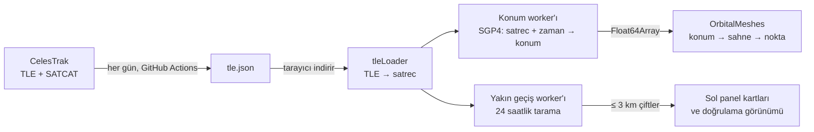

# Mimari: TLE'den ekrandaki noktaya

Bu belge, uygulamanın bir uydunun konumunu nasıl bulup çizdiğini, yakın geçişleri nasıl taradığını ve hesapları neden Web Worker'larda yaptığını kısaca anlatır. Ayrıntı için her bölümde ilgili dosyalara bağlantı var.

## 1. Veri: TLE nereden geliyor?

- **TLE (Two-Line Element):** Bir nesnenin yörüngesini, belirli bir andaki (epoch) yörünge elemanlarıyla anlatan iki satırlık metin. ABD Uzay Kuvvetleri'nin gözlemlerinden üretilir; [CelesTrak](https://celestrak.org) bunları herkese açık yayımlar.
- **Günlük güncelleme:** Her gün 03:17 UTC'de bir GitHub Actions iş akışı CelesTrak'tan kataloğu indirir, SATCAT'ten ülke/sahip bilgisini ekler, denetler ve yayımlar ([`scripts/fetch-tle.mjs`](../scripts/fetch-tle.mjs), [`docs/OPERATIONS.md`](OPERATIONS.md)). Sonuç yaklaşık 28.000 nesnelik `tle.json` dosyasıdır.
- **Arşiv:** Her günün kataloğu ayrıca `tle-archive` release'inde saklanır; `research/` ölçümleri bunları kullanır.

## 2. TLE → satrec

Tarayıcı `tle.json`'ı indirir ([`src/data/tleLoader.ts`](../src/data/tleLoader.ts)). Her nesne için:

1. TLE satırları satellite.js kütüphanesinin `twoline2satrec` fonksiyonuyla **satrec**'e çevrilir: SGP4'ün hesaplamaya hazır, sayılara açılmış yörünge elemanları.
2. **Katman** (LEO / MEO / GEO / HEO), nesnenin o an nerede olduğundan değil **yörüngesinin biçiminden** (ortalama yükseklik ve eksantriklik) bulunur ([`classifyOrbitFromElements`](../src/orbital/classify.ts)). Böylece aynı nesne her ziyarette aynı katmanda kalır.
3. **TLE yaşı:** Epoch'u katalog tarihinden **7 günden** fazla uzak olan TLE "eski" işaretlenir (`STALE_TLE_AGE_DAYS`). Eski TLE'li nesneler çizilir, ama yakın geçiş taramasına alınmaz: konumları birkaç km ile onlarca km arasında yanılabilir ([TLE yaşı ölçümü](../research/tle-age/README.md)).
4. Atmosfere girmiş nesneler ve hesaplanamayan TLE'ler çıkarılır.

## 3. SGP4: satrec + zaman → konum

**SGP4**, NORAD'ın TLE'lerle birlikte kullanmak için geliştirdiği yörünge modelidir (Hoots ve Roehrich, 1980; bugünkü sürüm Vallado vd., 2006). Bir TLE'yi ve bir zamanı alır, nesnenin o andaki konumunu ve hızını verir. Dünya'nın basık şeklini, atmosfer sürtünmesini ve Ay/Güneş'in çekimini basitleştirilmiş formüllerle hesaba katar.

- Uygulama satellite.js 7.1.0'ı kullanır. Bu kütüphanenin yayımlanmış referans sonuçlarla 1 mm içinde aynı sonucu verdiği doğrulandı ([SGP4 doğrulaması](../research/sgp4-verify/README.md)).
- Çıktı, Dünya merkezli bir koordinat sisteminde (SGP4'ün TEME sistemi; kodda "ECI" diye geçer) kilometre cinsinden konum ve km/s cinsinden hızdır ([`propagateObject`](../src/orbital/propagator.ts)). Ayrıca yükseklik, enlem ve boylam hesaplanır.
- **Maliyet:** Bu bilgisayarda bir nesne yaklaşık 2,2 µs sürer; **28.000 nesne yaklaşık 61 ms** ([performans ölçümü](../research/perf/README.md)). 60 Hz bir ekranda bir kareye 16,7 ms düştüğü için bu iş çizimle aynı yerde yapılamaz (bölüm 5).

## 4. Konum → ekrandaki nokta

- **Ölçek:** Konum, Dünya yarıçapı (6.371 km) **1 birim** olacak şekilde küçültülür ve Three.js'in "y yukarı" eksenlerine çevrilir ([`eciToScene`](../src/orbital/coordinates.ts)).
- **Çizim:** 28.000 nokta tek tek çizilmez. Hepsi tek bir **örneklenmiş (instanced) model**dir: ekran kartı aynı küre modelini, her nesne için ayrı konum ve renkle tek seferde çizer ([`InstancedOrbitalPoints`](../src/scene/InstancedOrbitalPoints.ts), [`OrbitalMeshes`](../src/scene/OrbitalMeshes.ts)).
- **Ne sıklıkla güncellenir:** Dünya görünümünde bir LEO uydusu karede bir pikselden çok daha az yol alır. Bu yüzden katalog her karede değil, aralıklarla güncellenir ([`catalogPacing.ts`](../src/scene/catalogPacing.ts)): 1× hızda en fazla saniyede iki kez (bir LEO uydusu yarım saniyede yaklaşık 4 km yol alır, ekranda bir pikselden az), zaman hızlandırılınca orantılı olarak daha sık. Hızlandırılmış zamanda yavaş bir cihaz zorlanmasın diye aralık, katalog işinin süresinin 4 katından kısa olmaz (en fazla 200 ms, yani saniyede en az 5 güncelleme). Kullanıcının yaptığı her değişiklik (seçim, filtre, arama) ve yakınlaştırılmış görünümler bu kurala takılmaz, hemen güncellenir.
- **Kare döngüsü:** [`SceneManager.ts`](../src/scene/SceneManager.ts) her karede şunları yapar: zamanı ilerletir, gerekiyorsa worker'dan yeni konumları ister, son gelen konumları noktalara yazar, seçili uydu, yer izi gibi ek çizimleri günceller ve sahneyi çizer. Bu karar mantığı test edilebilsin diye ayrı bir dosyadadır: [`sceneFrame.ts`](../src/scene/sceneFrame.ts).

## 5. Web Worker'lar

**Web Worker**, tarayıcıda ana iş parçacığından (main thread) ayrı çalışan bir JavaScript iş parçacığıdır. Ana iş parçacığı hem çizimi hem kullanıcının tıklamalarını yürütür; orada uzun süren bir hesap, ekranın takılmasına ve tıklamaların gecikmesine yol açar. Uygulamada iki worker vardır:

### Konum worker'ı

[`src/workers/propagation.worker.ts`](../src/workers/propagation.worker.ts), ana taraftaki aracısı [`PropagationWorkerBridge.ts`](../src/orbital/PropagationWorkerBridge.ts).

1. Başlangıçta ana iş parçacığı bütün TLE'leri worker'a bir kez gönderir (`init`).
2. Her katalog güncellemesinde yalnızca **zamanı** gönderir (`propagate`).
3. Worker bütün nesnelerin konumunu hesaplar ve sonucu tek bir sayı dizisi (`Float64Array`, nesne başına 10 sayı) olarak geri **aktarır**. Aktarma kopyalama değildir: bellek sahipliği ana tarafa geçer, bu yüzden 28.000 nesnelik veri neredeyse bedavaya taşınır.
4. Worker hâlâ meşgulken yeni bir zaman istenirse yalnızca **en sonuncusu** sıraya alınır; ekran hep en güncel sonucu kullanır.
5. **Güvenlik ağı:** Worker hata verir ya da 10 saniye cevap vermezse yeniden başlatılır (en fazla 2 kez). O sırada ve sonrasında konumlar ana iş parçacığında, saniyede en fazla 4 kez hesaplanır.

### Yakın geçiş worker'ı

[`src/workers/conjunction.worker.ts`](../src/workers/conjunction.worker.ts), yönetimi [`upcomingScan.ts`](../src/orbital/conjunction/upcomingScan.ts). Bölüm 6'daki 24 saatlik taramayı yapar. Bulduğu çiftleri tarama bitmeden parça parça gönderir, böylece liste boş beklemez. Sayfa görünmezken (telefon kilitliyken) pil için durur. Worker yoksa tarama ana iş parçacığında, ekranı dondurmamak için küçük parçalar halinde ve tarayıcı boşta kaldıkça yapılır. Bu yol çok daha yavaştır: 1.000 nesnede worker ile 2,6 saniye, worker olmadan 124 saniye ölçüldü.

Ölçüm için iki worker da `?worker=off` adresiyle kapatılabilir ([`src/perfFlags.ts`](../src/perfFlags.ts)).

## 6. 24 saatlik yakın geçiş taraması

**Soru:** Önümüzdeki 24 saatte hangi iki nesne birbirine 3 km'den fazla yaklaşacak? 28.000 nesnede yaklaşık 400 milyon çift vardır; hepsini her saniye karşılaştırmak imkânsızdır. Tarama bunu dört adımda çözer ([`upcomingSweep.ts`](../src/orbital/conjunction/upcomingSweep.ts)):

**0. Hangi nesneler?** Yörüngesinin en alçak noktası (perigee) 2.000 km'nin altında olanlar, yani alçak yörüngeye inenler. TLE'si 7 günden eski olanlar ve aynı yörünge verisini paylaşan nesneler (birbirine kenetli modüller, kopyalar) dışarıda kalır ([`screening.ts`](../src/orbital/conjunction/screening.ts)).

1. **Örnekleme:** Her **60 saniyede** bir, bütün bu nesnelerin konumu ve hızı SGP4 ile hesaplanır (24 saatte 1.440 örnek).
2. **Uzaysal ızgara:** Uzay, kenarı yaklaşık 500 km olan küplere bölünür ve her nesne bulunduğu küpe yazılır. Yalnızca aynı ya da komşu küplerdeki nesneler karşılaştırılır; birbirinden uzak çiftlere hiç bakılmaz ([`spatialGrid.ts`](../src/orbital/conjunction/spatialGrid.ts)).
   - **Neden 500 km?** İki LEO nesnesi birbirine en fazla yaklaşık 16 km/s hızla yaklaşabilir (karşı karşıya). İki örnek arasındaki 30 saniyede bu 480 km eder. Ağ bu yüzden 480 km + 8 km + 10 km pay = **498 km** genişliğindedir: bir sonraki örnekten önce en yakın noktasına gelecek hiçbir çift ağdan kaçamaz.
3. **Doğrusal en yakın nokta:** Ağa takılan her çift için, iki nesnenin o 60 saniyelik pencerede **düz çizgide** hareket ettiği varsayılır ve en yakın noktaları (CPA, *closest point of approach*) basit bir formülle bulunur. 30 saniyede yan yana iki nesneyi neredeyse aynı çekim etkilediği için bu yaklaşımın hatası 1 km'nin çok altındadır. En yakın nokta bu pencerenin içindeyse ve **8 km'den** (3 km + 5 km güvenlik payı) yakınsa çift aday olur.
4. **SGP4 ile hassaslaştırma:** Her aday için en yakın an, SGP4 ile tekrar tekrar hesaplanıp düzeltilerek milisaniyeye kadar bulunur. Son mesafe **3 km'den büyükse** çift atılır. Neredeyse aynı hızla birlikte giden çiftler (bağıl hız 0,05 km/s'nin altında) de atılır; onlar "yakın geçiş" değil, birlikte uçuş yapan nesnelerdir.

Sonra aynı fiziksel olayın tekrarları birleştirilir, sonuçlar zamana göre sıralanır ve sol panelde gösterilir (önce 5, "Daha fazla göster" ile tamamı, en fazla 30 tane saklanır). Tarama en fazla **5 dakikada bir** yeniden yapılır; kullanıcı zamanı 1 saatten fazla ileri ya da geri alırsa hemen yenilenir. Saat katalog tarihinden **7 günden** fazla uzaklaşırsa tahmin yapılmaz (`PREDICTION_RANGE_DAYS`), çünkü o kadar uzakta konumlar onlarca km yanılır.

> **Not:** [`liveScan.ts`](../src/orbital/conjunction/liveScan.ts) yalnızca "şu an" yakın olan çiftleri arayan eski bir taramadır. Uygulamada artık kullanılmıyor; yalnızca geliştirme modundaki bir hata ayıklama aracı ve testler onu çağırır.

## 7. 3 km eşiği ne anlama geliyor?

- **Ne:** Tarama, en yakın geçiş mesafesi **3 km veya daha az** olan çiftleri listeler (`THRESHOLD_KM`, [`settings.ts`](../src/orbital/conjunction/settings.ts)).
- **Ne değildir:** Bir çarpışma olasılığı değildir. Gerçek uydu operatörleri, her konumun **belirsizlik bilgisiyle** (kovaryans) çarpışma olasılığı hesaplar ve gerekirse manevra yapar. Herkese açık TLE'lerde bu belirsizlik bilgisi yoktur.
- **Neden 3 km bir "eleme" eşiğidir:** Herkese açık TLE'lerle hesaplanan konumlar kendi aralarında bile kilometre düzeyinde farklıdır: LEO'da (Starlink hariç) 1 günlük TLE'de ortanca 0,2 km, 7 günlükte 4 km ([TLE yaşı ölçümü](../research/tle-age/README.md)). 3 km'lik bir geçiş "dikkate değer bir yakınlık" demektir, "çarpışma riski" değil. Uygulamadaki açıklama metni de bunu söyler.
- **Doğrulama görünümündeki sözler:** Bir karta tıklanınca açılan görünümde mesafeye göre dikkatli bir dil kullanılır: 1 km'nin altı "çok yakın", 100 m'nin altı "100 m'nin altında (tahmin)" ([`verification.ts`](../src/orbital/conjunction/verification.ts)).

## 8. Dosya haritası

| Konu | Dosya |
|---|---|
| Günlük veri | [`scripts/fetch-tle.mjs`](../scripts/fetch-tle.mjs), [`.github/workflows/tle-refresh.yml`](../.github/workflows/tle-refresh.yml) |
| TLE okuma | [`src/data/tleLoader.ts`](../src/data/tleLoader.ts) |
| Katman, yükseklik | [`src/orbital/classify.ts`](../src/orbital/classify.ts) |
| SGP4 | [`src/orbital/propagator.ts`](../src/orbital/propagator.ts), [`propagationBatch.ts`](../src/orbital/propagationBatch.ts) |
| Konum worker'ı | [`src/workers/propagation.worker.ts`](../src/workers/propagation.worker.ts), [`PropagationWorkerBridge.ts`](../src/orbital/PropagationWorkerBridge.ts) |
| Çizim | [`src/scene/SceneManager.ts`](../src/scene/SceneManager.ts), [`sceneFrame.ts`](../src/scene/sceneFrame.ts), [`OrbitalMeshes.ts`](../src/scene/OrbitalMeshes.ts), [`catalogPacing.ts`](../src/scene/catalogPacing.ts) |
| Yakın geçiş taraması | [`src/orbital/conjunction/`](../src/orbital/conjunction/) (`upcomingSweep.ts`, `upcomingScan.ts`, `spatialGrid.ts`, `screening.ts`, `settings.ts`), [`src/workers/conjunction.worker.ts`](../src/workers/conjunction.worker.ts) |
| Ölçüm bayrakları | [`src/perfFlags.ts`](../src/perfFlags.ts) |

## Kaynaklar

- Hoots, F. R. ve Roehrich, R. L. (1980). *Spacetrack Report No. 3: Models for Propagation of NORAD Element Sets.*
- Vallado, D. A., Crawford, P., Hujsak, R. ve Kelso, T. S. (2006). *Revisiting Spacetrack Report #3.* AIAA 2006-6753.
- satellite.js: https://github.com/shashwatak/satellite-js
- CelesTrak: https://celestrak.org
- MDN, Web Workers API: https://developer.mozilla.org/docs/Web/API/Web_Workers_API
